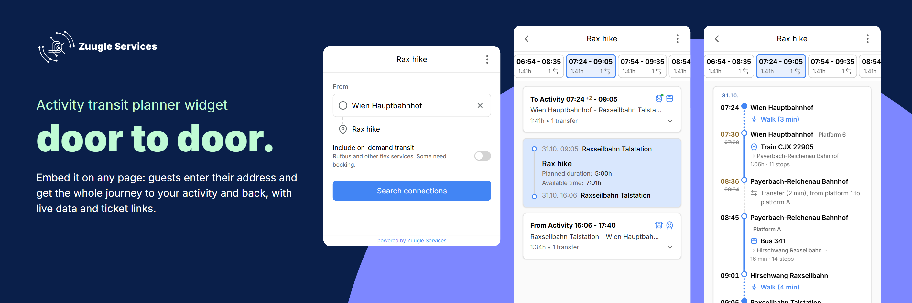

# Diana GreenConnect - Activity Transit Planner Widget



<div align="center">
    
</div>

A ready-to-embed widget that lets your visitors plan public transit to and from an activity: location autocomplete, date/time selection, and connection results with visual timelines.

## Quick Start

You need a **Client ID** and **Client Secret**. If you haven't received them from us yet, [get in touch](https://zuugle-services.com/en/diana-widget/) and we'll send them to you. The secret must stay on your server, so the setup has three steps.

### 1. Get an access token (on your server)

Exchange your credentials for a short-lived access token:

```sh
curl -X POST https://api.zuugle-services.net/o/token/ \
  -d grant_type=client_credentials \
  -d client_id=YOUR_CLIENT_ID \
  -d client_secret=YOUR_CLIENT_SECRET
```

The response contains an `access_token`. Do this in your backend (PHP, Node.js, Python, ...), **never in browser code**. See the [PHP example](docs/DOCUMENTATION.md#2-server-side-access-token-generation).

### 2. Add the widget to your page

```html
<div id="dianaWidgetContainer"></div>

<script>
window.dianaActivityConfig = {
  activityName: "Hiking Trip",
  activityStartLocation: "47.7262, 13.0421",
  activityStartLocationType: "coordinates",
  activityEndLocation: "47.7048, 13.0387",
  activityEndLocationType: "coordinates",
  activityEarliestStartTime: "09:00",
  activityLatestStartTime: "12:00",
  activityEarliestEndTime: "15:00",
  activityLatestEndTime: "18:00",
  activityDurationMinutes: 240,
  apiToken: "ACCESS_TOKEN_FROM_YOUR_SERVER"
};
</script>
<script src="DianaWidget.bundle.js"></script>
<script>
  new window.DianaWidget(window.dianaActivityConfig, "dianaWidgetContainer");
</script>
```

### 3. Handle token expiry (recommended)

Tokens expire after a while. Provide a callback that fetches a fresh one from your server so users never see an error:

```javascript
window.dianaActivityConfig.onApiTokenExpired = async () => {
  const res = await fetch("/api/get-new-diana-token");
  return (await res.json()).accessToken;
};
```

Without it, users see a "session expired, please reload" message.

## Common Options

| Option | Description |
|:--|:--|
| `language` | `"EN"` (default), `"DE"`, `"FR"`, `"IT"`, `"ES"`, `"TH"` |
| `timezone` | IANA timezone of the activity, default `"Europe/Vienna"` |
| `overrideActivityStartDate` | Pre-select a date (`YYYY-MM-DD`) |
| `multiday` | Enable multi-day activities |
| `share` | Show the share button (default `true`) |
| `dev` | Verbose logging and detailed config errors |

All options, including the full list of required fields, are in the [Configuration reference](docs/DOCUMENTATION.md#configuration).

## Styling

Theme the widget with CSS variables on its container:

```css
#dianaWidgetContainer {
  --primary-color: #ff6f61;
  --bg-secondary: #f8f8f8;
}
```

See [Styling & Theming](docs/DOCUMENTATION.md#styling--theming) for all variables and sizing tips (recommended minimum height: 620px).

## More Documentation

The [full documentation](docs/DOCUMENTATION.md) covers:

* Complete configuration reference and dynamic caching
* Token refresh in detail
* Controlling the widget from your page (`setSelectedDate`, `onDateChange`)
* Running the demo
* Development, architecture, TypeScript types
* Deployment and contributing
